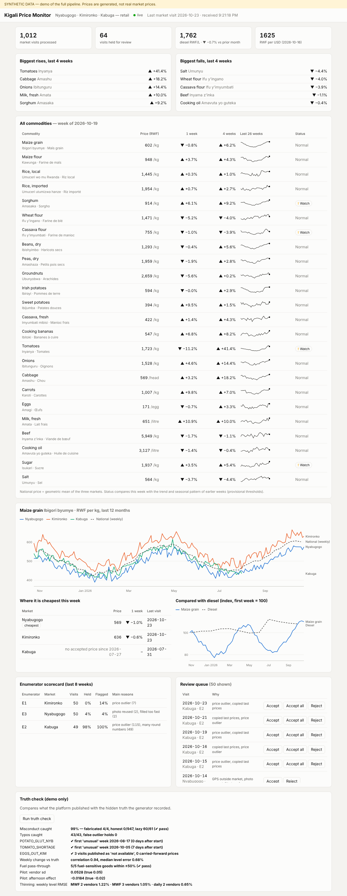

# End-to-end demo (synthetic data)

The full pipeline from `docs/PLATFORM_PLAN.md`, running on one machine. **Only the data is fake**: the
ingest worker, quality checks, database, analytics and API are the production code. A mock Kobo server
stands in for KoboToolbox; switching to the real thing means changing `KOBO_URL`, `KOBO_TOKEN` and
`KOBO_ASSET_UID`.

```
generator ─► mock Kobo ──webhook──► API /ingest/kobo ─┐
                  ▲                                    ├─► raw ─► QC ─► core (TimescaleDB) ─► caggs + weekly metrics
                  └──────── poll every 30 s ◄─ worker ─┘                                          │
                                                                    dashboard ◄── SSE (LISTEN/NOTIFY) ◄┘
```



## Run it

```bash
docker compose -f docker-compose.demo.yml up --build
# open http://localhost:8080
```

About a minute after start: the seed job has generated two years of history (Oct 2024 – Oct 2026) for
Nyabugogo, Kimironko and Kabuga, the worker has pulled ~1,000 submissions from the mock Kobo server,
and the dashboard is live. The mock Kobo clock then releases **one collection day every 2 minutes**
(`LIVE_SECONDS`), pushed by webhook, so you can watch the page update.

Reset everything: `docker compose -f docker-compose.demo.yml down -v`.

## Demo script

| # | Do | What it shows |
|---|---|---|
| 1 | Open the dashboard | watchlist, movers, sparklines, anomaly badges, "SYNTHETIC" banner |
| 2 | `curl -X POST localhost:8001/demo/advance` | new visits appear in ~1–4 s (webhook → QC → NOTIFY → SSE) |
| 3 | Click **Tomatoes** (or wait for the shortage weeks) | range of markets, national line, "Unusual" badge |
| 4 | Click **Irish potatoes**, look at Aug–Sep 2026 | Nyabugogo-only glut; cheapest-market table |
| 5 | Scorecard + review queue | E2 (lazy, copies prices) and E3 (fabricated visits) are caught; E1's typos held |
| 6 | **Accept** a queued E1 visit | visit published, the flagged typo stays out (**Accept all** would publish it) |
| 7 | **Run truth check** | QC precision/recall, event detection, tracking error, fuel pass-through, pilot analysis |
| 8 | Resilience: `docker compose -f docker-compose.demo.yml stop api`, then `curl -X POST "localhost:8001/demo/advance?days=2"`, then `start api` | webhooks fail while the API is down; the worker's poll recovers every submission, no duplicates |

Other controls: `POST /demo/webhook?fail=true` switches webhooks off (poll-only path);
`GET localhost:8001/demo/status` shows the simulated date and recent webhook results.

## What the synthetic world contains

Defined in `demo/synth/params.py` (seeded, identical every run; price levels are illustrative):

- **True prices** per commodity × market × day: level, market effect, two harvest seasons, slow inflation,
  pass-through from a synthetic diesel price (3-week lag), AR(1) shocks; vendor effects and noise on top.
- **Events**: diesel +12% (Jul 2026), Irish-potato glut at Nyabugogo (Aug–Sep), tomato shortage (+45%,
  from 28 Sep), eggs unavailable at Kimironko (3 visits, Oct).
- **Enumerators**: E1 honest with rare typos (×10); E2 lazy from Aug 2026 (copies ~70% of last prices,
  rounds the rest); E3 fabricates 4 visits (from home, 3 minutes, reused photo).
- **Pilot block** (31 Aug – 19 Sep 2026): daily visits, 5 vendors, afternoon visits for perishables — used
  by the variance decomposition and thinning test from `docs/PILOT_METHODOLOGY.md`.
- **External series**: diesel, RWF/USD, Kigali rainfall, a WFP-like benchmark index.

The generator also writes the truth (`truth.*` tables, demo database only) so results can be checked.

## Results on the default seed

From `python -m demo.truth_report` (also the dashboard's truth check):

| Check | Result | Target (DEMO_PLAN §4) |
|---|---|---|
| Misconduct visits held | 64/65 (fabricated 4/4, lazy 60/61) | ≥ 90% |
| Honest visits wrongly held | 0 / 947 | ≤ 10% |
| Typos held | all; 0 false outlier holds out of ~48,000 quotes | — |
| Events | potato glut flagged in week 1, tomato shortage in week 2, eggs shown "not available" (no carried-forward price) | each within a week |
| Weekly change vs truth | correlation 0.94; median level error 0.7% | — |
| Fuel pass-through | 5/5 fuel-sensitive goods within ±50% of the true elasticity | sign + ±50% |
| Pilot variance decomposition | vendor sd 0.053 (true 0.05); afternoon effect −1.8% (true −2%) | ±30% |
| Webhook → browser | ~1.3 s for visits, ~4 s including weekly metrics | < 10 s |
| Resilience (API down, 6 webhooks failed) | 6/6 recovered by polling, 0 duplicates | 0 lost |

Honest limits: small fuel effects (0.05) on volatile fresh produce cannot be recovered from two years of
weekly data (true value inside the 95% interval for 17/24 goods); anomaly thresholds are provisional,
not WFP's verified ALPS cut-offs.

## Tests

```bash
docker compose -f docker-compose.demo.yml run --rm \
  -e TEST_DATABASE_URL=postgresql://demo:demo@db:5432/commodities_demo_test worker python -m pytest -q tests
```

11 tests: matched-sample Jevons, geometric means, seasonal anomaly score, mock Kobo paging/auth,
exactly-once ingestion, duplicate deliveries, QC vs injected misconduct, typos, "not available"
handling, the tomato shortage flag, and the review "accept" rule.

## Not in this version (planned next)

Metabase dashboards, nightly backups to object storage and restore drill, Healthchecks.io heartbeat
(the worker supports `HEALTHCHECK_URL`), SMS/WhatsApp alerts, Kinyarwanda/French interface toggle,
map and flow views. The older `backend/` and `scraper/` services are untouched; the new pipeline lives in
`pipeline/`, `db/` and `demo/`.

## Going live (later)

1. Build the Kobo form with the same field names (validate against a real Kobo test project — the mock
   imitates Kobo's export format, it is not a copy of it).
2. Set `KOBO_URL=https://kf.kobotoolbox.org`, `KOBO_TOKEN`, `KOBO_ASSET_UID`; configure a Kobo REST Service
   pointing at `https://<server>.<tailnet>.ts.net/ingest/kobo` with header `X-Webhook-Secret`.
3. Run migrations without demo tables (`DEMO=0`), load the real vendor panel from the Week 0 census.
